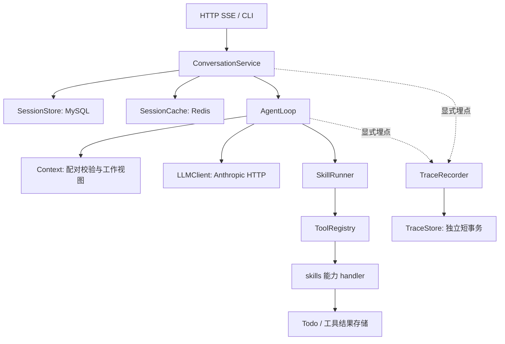

# Mini Agent

使用 Python 3.12、FastAPI、Pydantic、SQLAlchemy、MySQL 和 Redis 实现的最小可用 Agent。
核心 Runtime 是自行编写的 tool-use 循环，不依赖 LangGraph、OpenHands、OpenClaw 等 Agent 框架。
模型调用使用原生 Anthropic Messages 协议，通过 HTTP 客户端完成。

项目已包含：

- LLM 自主选择工具、参数校验、多工具执行、结果回灌和最终回答。
- 按用户与窗口隔离的 Session、持久化对话历史、普通追问及工具追问。
- 首尾原文保留、中段滚动摘要、大工具结果外置和有界引用读取。
- 请求 Token / 调用次数 / 超时限制、同错纠正、Reflexion 和 checkpoint 恢复。
- SSE 文本增量与工具 marker、自研 Trace / Span 埋点及查询。
- Docker Compose 基础设施、三环境配置、Alembic 迁移和自动化测试。

本文中的 **memory 指当前已实现的会话记忆与任务状态**。项目尚未实现跨 Session 的长期用户记忆、
向量检索、`memory_write` 或 `memory_search`。具体召回时机和模型输入位置见
[Memory 的召回与放置](#memory)。

## 阅读导航

- [1. 快速运行](#quickstart)
- [2. 环境与配置](#configuration)
- [3. 应用与命令行运行方式](#running)
- [4. HTTP / SSE 使用方式](#api)
- [5. 系统设计与数据流](#architecture)
- [6. Memory 的召回与放置](#memory)
- [7. Context 压缩与大结果引用](#context)
- [8. 预算、纠错与任务恢复](#recovery)
- [9. 工具接入](#tools)
- [10. Trace 与执行日志](#tracing)
- [11. 数据库迁移与容器运维](#operations)
- [12. 测试与验收](#testing)
- [13. 目录与阅读顺序](#layout)
- [14. 当前边界与常见问题](#limitations)

<a id="quickstart"></a>

## 1. 快速运行

### 1.1 准备环境

需要 Python 3.12、uv，以及已经启动的 Docker 和 Compose v2。
当前部署方式是 **Python 应用运行在宿主机，MySQL / Redis 运行在 Docker**；
Compose 使用 MySQL 8.4 和 Redis 7.4，文件中不包含应用镜像。

在仓库根目录执行：

```bash
uv sync --locked

# 仅首次配置时复制；已有本地配置不要覆盖。
cp .env.development.example .env.development
```

编辑 `.env.development`，设置自己的数据库和 Redis 密码。
初次验证可以保留 `AGENT_LLM_PROVIDER=echo`，无需模型 Key，不会产生模型调用费用。

```bash
# 启动基础设施，等待健康检查通过。
docker compose --env-file .env.development up -d --wait --wait-timeout 180

# 创建或升级业务表；服务启动时不会自动建表。
APP_ENV=development uv run alembic upgrade head

# 启动 FastAPI，默认监听 127.0.0.1:8000。
bash run_local.sh
```

首次初始化空数据卷时，MySQL 自动创建 `.env.development` 指定的数据库和应用账号，
默认库名为 `mini_agent_dev`。`DOCKER_MYSQL_ROOT_PASSWORD` 用于数据库管理；
应用使用独立的 `AGENT_MYSQL_USER`，不使用 root。
Redis 启用密码和 AOF 持久化。

默认端口如下：

| 服务 | 宿主机地址 | 容器内端口 |
| --- | --- | --- |
| FastAPI | `127.0.0.1:8000` | 应用运行在宿主机 |
| MySQL | `127.0.0.1:3306` | `3306` |
| Redis | `127.0.0.1:6379` | `6379` |

如果端口被占用，修改当前环境 dotenv 中的 `AGENT_MYSQL_PORT` / `AGENT_REDIS_PORT`。
Compose 和应用读取相同的宿主机端口配置，容器内端口保持不变。
同机运行时，`AGENT_MYSQL_HOST` / `AGENT_REDIS_HOST` 使用 `127.0.0.1`。

### 1.2 检查是否启动成功

```bash
curl http://127.0.0.1:8000/health
curl http://127.0.0.1:8000/health/ready
```

- `/health` 只检查进程存活，不连接数据库、Redis 或模型。
- `/health/ready` 检查已启用的 MySQL / Redis；不可用时返回 503，未启用时标记为 disabled。
- 就绪检查不调用模型，因此通过就绪检查不代表真实模型 Key、模型名称或工具选择已验证。
- 开发环境文档入口为 `http://127.0.0.1:8000/docs`。

### 1.3 最小无基础设施验证

只想检查 Python 依赖和 Loop 入口时，可以显式关闭外部服务并使用 stateless echo：

```bash
APP_ENV=testing \
AGENT_MYSQL_ENABLED=false \
AGENT_REDIS_ENABLED=false \
AGENT_LLM_PROVIDER=echo \
uv run python -m scripts.run_agent --stateless '你好，检查 Agent 入口'
```

该命令只回显输入，不保存历史、不创建持久化 Session，也不会自主选择工具。
要验证天气查询、待办写入等完整自然语言场景，需要配置真实模型；自动化测试使用 FakeLLM
验证这些链路，不依赖真实 Key。

<a id="configuration"></a>

## 2. 环境与配置

### 2.1 三套环境

| 环境 | `APP_ENV` | 公开配置 | 本地凭据文件 | 示例基础设施配置 |
| --- | --- | --- | --- | --- |
| 开发 | `development`，默认 | `config/development.toml` | `.env.development` | MySQL 3306 / Redis 6379，Redis DB 0 |
| 测试 | `testing` | `config/testing.toml` | `.env.testing` | MySQL 3307 / Redis 6380，Redis DB 1 |
| 生产 | `production` | `config/production.toml` | `.env.production` | 地址与端口按部署环境填写 |

`APP_ENV` 必须在启动前设置，不从 dotenv 中选择环境。
配置入口为 [server/config.py](server/config.py)，只加载所选环境的 dotenv，
不读取通用 `.env`，不回退读取其他环境文件。

配置优先级从高到低为：

```text
显式初始化参数
  > 系统环境变量
  > 当前环境 dotenv
  > secrets source
  > 当前环境 TOML
  > Settings 字段默认值
```

配置加载后缓存，修改配置需要重启进程。
`.env.*.example` 可以提交；真实 `.env.development`、`.env.testing`、`.env.production`
已加入忽略规则，不应提交凭据。配置使用 `SecretStr` 避免直接展示原始密码和 Key。

普通字段使用 `AGENT_` 前缀，嵌套配置使用双下划线：

```dotenv
AGENT_MYSQL_HOST=127.0.0.1
AGENT_CONTEXT__WINDOW_TOKENS=32000
AGENT_TRACING__ENABLED=true
```

列表使用 JSON，例如 `AGENT_CORS_ORIGINS='["https://app.example.com"]'`。
Compose 的 `COMPOSE_PROJECT_NAME` 和 `DOCKER_MYSQL_ROOT_PASSWORD` 属于容器配置，
不属于模型可填写的业务参数。

### 2.2 接入真实模型

在选定环境的凭据文件中配置：

```dotenv
AGENT_LLM_PROVIDER=anthropic
AGENT_LLM_BASE_URL=https://your-provider.example/anthropic
AGENT_LLM_API_KEY=<填写实际密钥>
AGENT_LLM_MODEL=<填写实际模型名称>
AGENT_LLM_AUTH_HEADER=x-api-key
AGENT_LLM_TIMEOUT=60
AGENT_LLM_MAX_TOKENS=4096
AGENT_LLM_COUNT_TOKENS=true
```

这里的 `anthropic` 表示请求采用 Anthropic Messages 格式，也可以连接兼容服务。
Base URL 填写 API 根地址，客户端追加 `/v1/messages`；如果根地址以 `/v1` 结尾，
则只追加 `/messages`。直连 Anthropic 的根地址可填写 `https://api.anthropic.com`。

默认通过 `x-api-key` 认证。兼容服务要求 Bearer Token 时，将
`AGENT_LLM_AUTH_HEADER` 设为 `authorization`。模型名称按服务商提供的名称填写。
HTTP 客户端使用 `trust_env=False`，不自动读取系统代理。

HTTP Chat 的主决策调用使用流式响应；CLI 默认获取完整单轮响应。
摘要和 Reflexion 使用同一模型客户端，但不向用户公开其生成文本。
模型客户端不执行工具，也不自行重试或回退到其他模型。

### 2.3 启用测试环境基础设施

```bash
# 仅首次配置时复制，并填写自己的测试密码。
cp .env.testing.example .env.testing

docker compose --env-file .env.testing up -d --wait --wait-timeout 180
APP_ENV=testing AGENT_MYSQL_ENABLED=true uv run alembic upgrade head
APP_ENV=testing AGENT_MYSQL_ENABLED=true AGENT_REDIS_ENABLED=true uv run python main.py
```

测试公开配置和示例默认关闭应用对 MySQL / Redis 的连接，因此启动测试应用或迁移时需要显式启用。
Compose 启动容器与应用是否启用连接是两件事。测试库必须使用专用的 `_test` 后缀数据库，
不能把开发库地址作为集成测试目标。

<a id="running"></a>

## 3. 应用与命令行运行方式

### 3.1 FastAPI 启动方式

以下入口创建的是同一个应用：

```bash
bash run_local.sh
APP_ENV=development uv run python main.py
APP_ENV=development uv run uvicorn main:app --host 127.0.0.1 --port 8000 --reload
```

`run_local.sh` 默认选择 development，也允许提前设置 `APP_ENV`。
`python main.py` 读取 Settings 中的 host、port、reload、log_level；
直接运行 Uvicorn 时，这些进程参数由命令行控制。

PyCharm 使用 `.venv/bin/python`，入口选择 `main.py`，环境变量设置 `APP_ENV=development`。

### 3.2 命令行会话与普通追问

```bash
# 每次不传 session-id 都创建一个新窗口，并打印 session_id。
APP_ENV=development uv run python -m scripts.run_agent \
  --user-id user-a --session-title 天气 '查杭州明天天气，并记待办带伞'

APP_ENV=development uv run python -m scripts.run_agent \
  --user-id user-a --session-title 周报 '记待办：周五提交周报'

# 填入天气窗口实际返回的 ID，继续该窗口的对话。
APP_ENV=development uv run python -m scripts.run_agent \
  --user-id user-a --session-id '<天气窗口ID>' '列出这个窗口的待办'
```

同一用户的两个窗口拥有独立历史、摘要、当前任务和待办作用域。
`--user-id` 只是本地演示身份，不构成登录认证。

**普通追问与恢复未完成任务不同：**

| 操作 | CLI | 行为 |
| --- | --- | --- |
| 已完成上一任务，接着提问 | `--session-id` + 新消息 | 创建新任务，加载同 Session 历史 |
| 任务暂停或等待补充，继续执行 | `--session-id --continue-task` | 恢复原 task_id 和 checkpoint，重新分配本次预算 |
| 取消当前任务 | `--session-id --cancel-task` | 停止后续执行，不撤销已完成副作用 |
| 结果未知且已核实未执行 | `--continue-task --retry-operation <operation_id>` | 显式允许重试该未知操作 |

```bash
uv run python -m scripts.run_agent --session-id '<ID>' --continue-task '补充信息或继续'
uv run python -m scripts.run_agent --session-id '<ID>' --cancel-task '取消'
```

未完成任务不能被普通新请求覆盖。反过来，已完成任务的 `continue` 会复用最终答案，
不会重新调用模型；希望提出新问题时应使用默认的新任务请求。
CLI 默认打印 session_id、最终文本、停止原因和模型调用次数；启用 Trace 时还打印 trace_id。

### 3.3 生产运行

准备 `.env.production` 或通过部署系统注入变量，填写数据库连接、真实模型配置和网关令牌：

```dotenv
AGENT_API_TOKEN=<可信网关使用的服务令牌>
```

```bash
uv sync --locked --no-dev
APP_ENV=production uv run --no-dev alembic upgrade head
APP_ENV=production uv run --no-dev python main.py
```

生产默认关闭 reload 和文档入口，监听 `0.0.0.0`。配置缺失或使用 echo 模型会导致启动校验失败。
会话 API 在生产还会检查 `AGENT_API_TOKEN`：未配置时返回 503；调用方需要携带对应 Bearer Token。
这个服务令牌与模型 API Key 不同。

当前使用单 worker。进程内会话锁不提供跨 worker / 多实例互斥，增加 worker 数量前需要另行实现
跨进程执行协调。迁移作为独立步骤执行，不由服务启动隐式触发。

<a id="api"></a>

## 4. HTTP / SSE 使用方式

### 4.1 身份与接口列表

所有 `/sessions` 接口要求 `X-User-ID`。它是开发环境或可信网关注入的身份，
不是终端用户登录认证；生产应由已认证的网关负责校验用户并注入该字段。
配置服务令牌后同时传 `Authorization: Bearer <服务令牌>`。

| 方法 | 路径 | 功能 |
| --- | --- | --- |
| POST | `/sessions` | 创建窗口，body：`{"title":"天气"}` |
| GET | `/sessions` | 当前用户的窗口列表，支持 limit / offset |
| GET | `/sessions/{id}` | 读取窗口信息 |
| GET | `/sessions/{id}/messages` | 历史分页，支持 after / limit |
| POST | `/sessions/{id}/chat` | SSE 流式聊天、继续或取消任务 |
| GET | `/sessions/{id}/task` | 当前任务、checkpoint、用量、操作与错误摘要 |
| GET | `/sessions/{id}/traces` | 请求追踪列表，支持 task_id / limit / offset |
| GET | `/sessions/{id}/traces/{trace_id}` | 单次请求及步骤树 |

会话及 Trace 查询均校验用户与窗口归属。公开消息历史过滤 thinking 等内部块，
内部用于模型回灌的历史仍保存完整协议。

### 4.2 创建两个窗口并分别对话

```bash
# 分别记录两次返回的 id。
curl -sS -X POST http://127.0.0.1:8000/sessions \
  -H 'X-User-ID: user-a' -H 'Content-Type: application/json' \
  -d '{"title":"天气"}'

curl -sS -X POST http://127.0.0.1:8000/sessions \
  -H 'X-User-ID: user-a' -H 'Content-Type: application/json' \
  -d '{"title":"周报"}'

# 将占位符替换为实际 ID。
WEATHER_SESSION_ID='<天气窗口ID>'
REPORT_SESSION_ID='<周报窗口ID>'

curl -N -X POST "http://127.0.0.1:8000/sessions/${WEATHER_SESSION_ID}/chat" \
  -H 'X-User-ID: user-a' -H 'Content-Type: application/json' \
  -d '{"message":"查杭州明天天气，并记待办带伞"}'

curl -N -X POST "http://127.0.0.1:8000/sessions/${REPORT_SESSION_ID}/chat" \
  -H 'X-User-ID: user-a' -H 'Content-Type: application/json' \
  -d '{"message":"记待办：周五提交周报"}'

curl -N -X POST "http://127.0.0.1:8000/sessions/${WEATHER_SESSION_ID}/chat" \
  -H 'X-User-ID: user-a' -H 'Content-Type: application/json' \
  -d '{"message":"我的待办有哪些？"}'
```

上述工具选择需要真实模型。echo 配置只会回显输入，无法验证“查天气再记待办”的模型决策。
天气、搜索结果本身仍是明确标记的 Mock；Todo 才会实际写入数据库。

### 4.3 请求 body 与任务控制

新任务或普通追问：

```json
{"message":"接着刚才的话题，我的项目名称是什么？"}
```

继续未完成任务、补充缺少的信息：

```json
{"action":"continue","message":"left 的值是 12，请继续"}
```

取消当前任务：

```json
{"action":"cancel"}
```

继续和取消可以省略 message。新任务必须显式传入非空 message；仅在文本中写“继续”不会把
默认 `new` 请求变成任务恢复操作。

若 `GET /sessions/{id}/task` 显示某个写操作为 unknown，应先核实外部状态。
仅确认没有执行后，才使用以下字段放行；操作 ID 必须属于当前任务的未知操作：

```json
{
  "action":"continue",
  "message":"已核实该操作没有执行",
  "confirmed_not_executed":["<operation_id>"]
}
```

### 4.4 SSE 事件与前端渲染

响应为 `Content-Type: text/event-stream`。每帧由 `event:`、一行 JSON `data:` 和空行组成。
使用 POST + fetch 流读取，或 `curl -N`；浏览器原生 EventSource 不适用于这个带 JSON body 的 POST。

| 事件 | 数据 | 前端用途 |
| --- | --- | --- |
| start | session_id、trace_id | 关联窗口与追踪记录 |
| text_delta | text、round | 追加主模型公开文本 |
| tool_use | name、tool_use_id、status、mark | 创建或更新调用中状态卡 |
| tool_result | name、tool_use_id、status、is_error、duration_ms、reused、mark | 更新同一工具卡 |
| heartbeat | 空对象 | 保持连接，不改变对话 |
| done | 完整 ChatResponse | 确认最终答案、任务状态和用量 |
| error | code、message | 本次流以错误终止，不再发送 done |

工具标记，示意如下；实际 ID 以运行结果为准：

```text
event: tool_use
data: {"name":"calculator","tool_use_id":"call_1","status":"running","mark":"[工具调用中 · calculator]"}

event: tool_result
data: {"name":"calculator","tool_use_id":"call_1","status":"success","is_error":false,"duration_ms":1.2,"reused":false,"mark":"[tool=calculator · 工具 OK]"}
```

按 `tool_use_id` 更新同一张卡，安全渲染 `mark`。失败显示“工具失败”，未知写结果显示
“结果待确认”，恢复命中已有结果显示“结果已恢复”。恢复不会伪造一次新的实际调用。
标记只用于展示，不写入模型历史；SSE 不发送原始工具参数、thinking 或供应商签名。
当前仓库没有前端应用，提供的是后端事件协议。

`done` 保留 ChatResponse 的字段：

| 字段 | 含义 |
| --- | --- |
| session_id / turn_id | 窗口 ID / task_id |
| text | 最终回答或暂停提示 |
| stop_reason / task_status | 停止原因 / 任务状态 |
| rounds | 本次请求的模型生成调用次数，含摘要和 Reflexion |
| tool_traces | 工具执行摘要；任务恢复时可能包含此前请求的记录 |
| request_tokens / total_tokens | 本次请求用量 / 当前任务累计用量 |
| usage_estimated | 用量是否包含保守预留值 |
| trace_id | 本次请求追踪 ID；未启用采集时可为空 |

流中可能含工具调用前的说明。`text_delta` 在收到最终状态前不代表完整成功，
最终答案以 `done.text` 为准，不要把同一段最终文本重复追加。
暂停也会发送 done，必须检查 `task_status`；不能只根据“收到 done”显示任务完成。

### 4.5 错误、心跳与断连

鉴权、参数及会话归属校验在打开 SSE 前执行，失败时返回正常 HTTP 错误。
窗口忙碌、任务冲突及运行异常在流内执行阶段发生时，通过 error 事件返回，
此时 HTTP 响应可能已经是 200。例如未完成任务收到普通新请求时，流中返回 TASK_PENDING，
客户端应让用户选择继续或取消。

默认空闲心跳为 15 秒，可通过 `AGENT_SSE_HEARTBEAT_SECONDS` 调整。
响应设置 `Cache-Control: no-cache`、`X-Accel-Buffering: no`，事件队列有界并提供反压。
部署链路中的反向代理也应允许流式转发。

断连时取消本次执行，等待 Loop 保存检查点及 Trace 收尾，并释放窗口锁。
存储不可用时不能保证最新步骤成功保存；用户可查询 task 后显式 continue。
没有基于 Last-Event-ID 的事件重放，也不会因客户端重连自动重跑工具。

<a id="architecture"></a>

## 5. 系统设计与数据流

### 5.1 模块职责



| 模块 | 职责 | 不承担的职责 |
| --- | --- | --- |
| `server/routes/sessions.py` | 身份校验、参数校验、SSE 响应及查询接口 | 不复制 Loop |
| `server/conversations.py` | 窗口串行、历史加载、任务生命周期、检查点及原文提交 | 不按关键词选择工具 |
| `server/agent_loop.py` | 模型决策、协议校验、工具编排、预算与恢复 | 不保存实例级可变会话历史 |
| `server/llm.py` | 请求模型、收集流式块、解析响应和 usage | 不执行工具 |
| `server/context.py` | 安全消息单元、摘要覆盖边界、结果视图、模型输入排列 | 不删除原文 |
| `server/tools.py` | 工具定义、Schema 和 handler 注册 | 不执行工具 |
| `server/skill_runner.py` | 定位工具、Pydantic 校验、执行超时、通用错误封装 | 不调用 Loop |
| `skills/<能力>/handler.py` | 一项具体业务能力 | 不构造 Anthropic 消息、不决定后续循环 |
| `server/sse.py` | 公开事件、marker、心跳、断连收尾 | 不编排任务 |
| `server/tracing.py` | 请求内采集、有界脱敏、埋点故障隔离 | 不参与业务提交或工具重试 |

应用 lifespan 创建模型 HTTP 客户端、数据库连接池和 Redis 客户端，退出时关闭资源。
依赖通过参数注入，模型可填写的参数中不包含可信用户 / Session 身份。

### 5.2 一次请求的执行过程

```text
1. 校验用户、窗口归属与输入
2. 取得进程内窗口锁，创建本次 Trace，发送 SSE start
3. 新任务：加载历史与会话摘要；继续任务：恢复当前 checkpoint
4. 创建本次执行预算，保留任务累计状态
5. 若有待处理工具，先恢复或处理这些操作，完成整批结果配对
6. 主模型调用前生成工作 Context，按需压缩中段
7. 请求 LLM：文本增量公开推送，完整内容块内部收集
8. 收齐响应后校验整轮 tool_use ID 与停止原因
9. 有工具：逐个校验参数、执行、保存结果，回灌整批 tool_result，继续循环
10. 无工具：返回 text；任务完成后原子提交原始历史与摘要状态
11. 结束 Trace，发送 done；执行异常发送 error
```

一轮 assistant 中存在多个工具时，执行前先校验整轮的协议结构，防止执行一半才发现重复或缺失 ID。
工具按顺序执行，结果集中放在紧随其后的一个 user 消息中。
模型返回 `max_tokens` 时不执行该响应中的工具，避免使用截断参数。

### 5.3 持久化模型

| 表 | 保存内容 | 主要关联 |
| --- | --- | --- |
| `agent_session` | 用户归属、标题、消息水位、context_state、task_state | 用户与窗口 |
| `agent_message` | 已完成任务的完整有序原始消息 | session_id、turn_id、sequence |
| `todos` | 待办内容、状态、创建去重键 | user_id、session_id |
| `agent_tool_result` | 外置的大工具结果原文 | 稳定 operation_id / ref、用户、窗口 |
| `agent_trace` | 一次请求的时间、状态、用量和摘要 | 用户、窗口、task_id |
| `agent_span` | 模型、工具、压缩、恢复等步骤 | trace_id、parent_span_id、sequence |

会话业务仍由 `agent_session` 和 `agent_message` 两张表承载；工具业务与可观测性使用各自表。
消息水位 `version` 表示当前已经提交的消息数量，不等同于用户对话轮数。
一次任务可以跨多次请求，最终消息通过同一个 `turn_id` 归组。

### 5.4 三种不能混用的数据

| 数据 | 作用 | 是否允许压缩改变 |
| --- | --- | --- |
| 原始消息 | 保留精确输入、assistant 块及完整工具结果，最终提交历史 | 不允许 |
| 模型工作 Context | 当前请求实际发送给 LLM 的首部、摘要、尾部及结果引用视图 | 允许按安全边界替换中段 |
| 执行状态 / checkpoint | 工具是否执行、是否结果未知、错误次数、预算、恢复点 | 不由摘要推断或替代 |

`TaskState.messages` 保留原始上下文，`task_messages` 单独保留本任务待提交的原始消息。
生成工作视图不修改这两个原文集合，历史提交也不按压缩后的数组下标切片。

<a id="memory"></a>

## 6. Memory 的召回与放置

### 6.1 当前有哪些 memory

这里的“召回”是确定性地加载已知作用域内的数据，或按精确 ref 读取结果，
不是基于向量相似度的检索。

| 类型 | 存储位置 | 作用域 | 进入模型输入的方式 |
| --- | --- | --- | --- |
| 对话原文 | `agent_message`，Redis 可缓存 | 同用户、同 Session | 新任务加载后生成工作 Context |
| 滚动摘要 | `agent_session.context_state` | 同 Session | 替换原文中已覆盖的中段，作为 user 资料消息 |
| 当前任务记忆 | `agent_session.task_state` | 当前 Session 的一个任务 | 恢复原始上下文、摘要与待执行状态，再生成工作视图 |
| 外置工具结果 | `agent_tool_result`，Redis 可缓存 | 同用户、同 Session | 先回灌 ref，模型按需调用 read_tool_result 读取 |
| Todo 业务状态 | `todos` | 同用户、同 Session | 模型主动调用 todo，结果作为 tool_result 回灌 |
| 纠错结论 | 当前 task_state 与错误工具反馈 | 当前任务 | 简短提示 / Reflexion 结论加入对应 tool_result |

Trace、Span、SSE marker 是运行记录或展示信息，不属于模型记忆，不会自动塞进 Context。
本项目没有独立用户画像表，不会把一个窗口的事实、偏好或待办自动带到另一个窗口。

### 6.2 召回时机一：新任务或普通追问到达时

当请求使用默认 `action=new` 且没有未完成任务时：

```text
校验 user_id / session_id
  → 读取 agent_session 的消息水位 version
  → 按用户、窗口、水位读取 Redis 历史缓存
  → 命中：使用该版本完整历史
    未命中 / 缓存不可用 / 数据不可解析：回源 MySQL
  → 读取当前会话的 context_state
  → 追加本次用户输入
  → 在首次模型决策前生成工作 Context
```

缓存键包含用户与窗口的作用域摘要以及历史水位，旧版本缓存不会作为新版本历史使用。
默认历史缓存 TTL 为 300 秒，可用 `AGENT_SESSION_CACHE_TTL_SECONDS` 调整。
过期只意味着下一次回源，不意味着会话遗忘。

即使用户只是问“我刚才说的项目叫什么”，也会经过这条历史加载路径，
不需要关键词触发 memory 查询。模型再根据已组装的上下文决定直接回答还是调用工具。

### 6.3 召回时机二：继续未完成任务时

`action=continue` 优先恢复同一任务的 checkpoint，而不是根据最近几条公开历史重新猜测进度：

```text
读取 task_state
  → 恢复 task_id、原始消息、摘要覆盖范围、结果引用视图
  → 恢复 pending / unknown / done 操作与稳定 operation_id
  → 保留失败记录、复盘状态和任务累计 Token
  → 重置本次请求的 Token 与模型调用次数
  → 先处理未完成工具批次，再追加用户补充信息
  → 进入下一次主模型决策
```

公开消息表可能还没有这项任务的完整消息，因此不能只靠 `agent_message` 恢复。
checkpoint 中尚未配对的工具交互先完成配对，再调用模型；不会把悬空 tool_use 直接发给 LLM。
已完成任务的 continue 只复用答案，取消后的任务不能直接继续。

### 6.4 召回时机三：一次 Loop 内工具执行结束后

每轮工具执行完成后，将整批 `tool_result` 回灌为 user 消息，下一次主模型调用即可读取。
这一步不需要重新查询整段会话历史，也不需要经过向量检索。

- 小结果直接进入工作 Context。
- 大结果先持久化，工作 Context 只放摘要、部分预览和 ref。
- todo 的列表或单项内容只在工具调用结果中出现，不会每次请求都自动加载全部待办。
- search 只搜索固定 Mock 资料集，不搜索历史消息，不承担 memory 检索。
- 同错提示与简短复盘结论绑定对应的错误工具结果，不另外伪造 system 消息。

工具调用的业务字段由模型决定；读取范围中的用户、Session、操作标识由服务端提供。

### 6.5 召回时机四：模型需要大结果的精确细节时

模型看到 ref 后，可以调用 `read_tool_result(ref, offset, limit)`。
读取过程验证用户与窗口作用域，先读取 Redis，未命中时回源 `agent_tool_result`。
返回片段、next_offset、total_chars、has_more 和 original_is_error，再作为 tool_result 回灌。

读取使用 Unicode 字符偏移：默认每页 1024 字符，最大 2048 字符。
读取本身也是一次工具调用，后续模型决策仍计入正常请求预算。
若缓存与原文都不可用，返回 NOT_FOUND 并暂停等待用户处理，不自动重跑原工具。

### 6.6 召回后的 memory 放在哪里

实际 Anthropic 请求中，system 和工具 Schema 是顶层字段，memory 放在 messages 中：

```text
请求顶层：
  system = 固定行为约束
  tools  = 工具 name / description / input_schema

messages：
  首部若干完整原始消息单元
  user：历史摘要（明确标识为资料，不是系统指令）
        如当前任务目标已被摘要覆盖，再附该目标的用户原文
  最近若干完整原始消息单元
  当前请求、已配对的工具交互及其后续消息（按原始时间顺序）
```

上面的“当前请求”属于尾部消息，不会额外重复插入一次。
没有摘要时发送完整工作消息；有摘要时，只用一条 user 资料消息替换指定中段。
外置结果视图保持原 tool_result 的消息位置、调用 ID 和错误标识。

各类信息的放置原则：

| 信息 | 放置方式 | 原因 |
| --- | --- | --- |
| 固定行为规则 | 顶层 system | 与会话内容分离 |
| 工具描述与参数 Schema | 顶层 tools | 供模型自主决策 |
| 用户原话 | user 消息，原文保留区不改写 | 保留约束与追问依据 |
| assistant 回答 | assistant 原始内容块 | 保持对话顺序 |
| thinking / signature | 仅在保留的完整 assistant 协议块中回灌 | 保证供应商协议完整，不作为可展示长期记忆 |
| 工具结果 | 紧随对应 assistant 的 user / tool_result | 保证配对与来源 |
| 历史摘要 | 中段的 user 资料消息 | 避免把历史内容提升为系统规则 |
| checkpoint 标识、预算、Trace、marker | Runtime 管理，不整体注入 Prompt | 属于执行控制或展示信息 |

摘要模型不接收 thinking/signature，SSE、公开历史和 Trace 也不展示这些内部字段。
系统只保留模型实际返回的协议块，不要求模型输出额外的完整思考过程。

### 6.7 写回时机与一致性

执行中保存 task_state 检查点，原始消息和工作摘要都随任务进度保留。
任务完成后，通过一个短事务同时提交：

```text
本任务完整原始消息
  + 更新后的会话摘要与结果视图
  + history_saved=true 的完成检查点
  + 新消息水位
```

暂停、等待用户或中断时，未配对工具块只留在 checkpoint，不写入公开历史。
若在完成检查点保存后、历史提交前中断，下次请求先补提交，不重复调用模型或工具。
Redis 历史缓存按新水位使用新的 key，不承担消息提交或任务调度职责。

### 6.8 记忆能力的边界

- 跨窗口不会自动共享事实或待办，即使 user_id 相同。
- 摘要是有损的，不能保证记住所有早期细节；精确值、ID 和约束需要在摘要中尽量保留。
- MySQL 保留原文，不代表所有原文每轮都发送给模型。
- 当前没有让模型任意回查历史消息的 read_history 工具；用户可以通过 HTTP 历史接口查看原文。
- read_tool_result 只读取已外置的工具结果，不能用任意消息 ID 代替 ref。
- Runtime 不依赖模型摘要判断“某个写操作是否执行过”，以结构化操作状态和持久化结果为准。

<a id="context"></a>

## 7. Context 压缩与大结果引用

### 7.1 首尾保留与安全切点

工作 Context 采用：

```text
[开头原文 A] + [中段 B 的滚动摘要] + [最近原文 C]
```

默认保留开头 2 个和最近 6 个安全消息单元。它们不是固定的消息条数：
普通消息单独成单元；一个 assistant 中全部 tool_use 与紧随其后的整批 tool_result 合为一个单元。

```text
assistant：text + thinking/signature + tool_use A + tool_use B
user：tool_result A + tool_result B
```

这一组只能一起保留或一起进入摘要，不能从中间切开。
两侧切点均检查 ID 完整对应，拒绝重复、缺失、孤立结果及悬空调用。
当前未完成交互不参与压缩，也不会只留下一个工具结果而丢失其调用。

### 7.2 触发、压缩与失败处理

每次主模型决策前计算完整输入量：system + 工具 Schema + 工作 messages。
容量阈值基于预留输出和安全余量后的可用输入空间：

```text
可用输入容量 = context.window_tokens - 单次输出预留 - token_safety_margin
软阈值 = 可用输入容量 × soft_ratio
硬阈值 = 可用输入容量 × hard_ratio
```

默认窗口 32000、输出预留 4096、安全余量 256，因此输入容量为 27648 Token，
软阈值约 19.4k，硬阈值约 23.5k。窗口应按实际部署模型配置，不从模型名猜测。

| 条件 | 行为 |
| --- | --- |
| 低于软阈值 | 使用当前工作视图 |
| 达到软阈值，存在可压缩中段且未受频次限制 | 同步生成摘要并验证缩小效果 |
| 达到硬阈值 | 绕过软限频，必须处理容量问题后再继续 |
| 摘要输入本身过长 | 缩小为完整单元组成的前缀，按预算分批处理 |
| 软阈值下摘要失败，旧视图仍可容纳 | 保留旧状态，可继续主模型决策 |
| 硬阈值下无安全切点、摘要失败或无缩小效果 | 保存进度并暂停，不硬截消息 |

新摘要由“旧摘要 + 本次新增待压缩中段”生成，不从零覆盖旧摘要。
保留用户目标、约束、修正决定、事实来源、关键 ID / ref、数值单位、已完成动作、
未完成事项和纠错结论；区分用户陈述、工具结果、模型建议和 Mock 信息。

摘要为同步辅助模型调用，计入本次请求的 Token、模型调用次数和总超时。
候选摘要通过结构及容量检查后才替换旧摘要；失败不改变原文和已有覆盖范围。
当前没有后台压缩任务。

### 7.3 大工具结果外置

超过 `inline_max_bytes` 的工具结果先完整保存到 `agent_tool_result`，再发布 ref。
结果表独立于当前 checkpoint，任务取消或创建新任务不会覆盖原文。

工作视图仍然使用标准 tool_result，保留 tool_use_id、is_error，content 替换为：

```json
{
  "ref":"<稳定操作ID>",
  "summary":"结果较大，使用 read_tool_result 分页读取。",
  "preview":"<明确标记不完整的部分原文>",
  "preview_is_partial":true,
  "size_bytes":245000,
  "has_more":true
}
```

这段 JSON 实际序列化在 tool_result.content 字符串中；不是新的 Anthropic 消息类型。
摘要和预览是有界展示，不保证已涵盖完整证据。模型需要精确细节时按 ref 分页读取。
有界读取的结果不再次外置成新指针，避免指针套指针。

Redis 只缓存原文读取结果，默认 TTL 3600 秒；过期后从 MySQL 回源。
未启用结果持久化的 stateless 模式遇到大结果会暂停，不发布无效引用。
原始历史、外置结果和 Trace 当前都没有自动清理策略。

### 7.4 相关配置

| 环境变量 | 默认值 | 含义 |
| --- | --- | --- |
| `AGENT_CONTEXT__WINDOW_TOKENS` | 32000 | 模型上下文容量 |
| `AGENT_CONTEXT__KEEP_HEAD_UNITS` | 2 | 首部安全单元数 |
| `AGENT_CONTEXT__KEEP_TAIL_UNITS` | 6 | 尾部安全单元数 |
| `AGENT_CONTEXT__SOFT_RATIO` | 0.70 | 软阈值占可用输入容量比例 |
| `AGENT_CONTEXT__HARD_RATIO` | 0.85 | 硬阈值比例，必须大于软阈值 |
| `AGENT_CONTEXT__SUMMARY_MAX_TOKENS` | 1024 | 摘要输出上限，还受请求预算限制 |
| `AGENT_CONTEXT__MIN_INTERVAL_SECONDS` | 60 | 软压缩最小间隔，硬阈值可绕过 |
| `AGENT_TOOL_RESULT__INLINE_MAX_BYTES` | 8192 | 原始结果外置阈值，按 UTF-8 字节计 |
| `AGENT_TOOL_RESULT__PREVIEW_CHARS` | 256 | 引用视图的预览字符数 |
| `AGENT_TOOL_RESULT__CACHE_TTL_SECONDS` | 3600 | 原文读取缓存 TTL |
| `AGENT_SESSION_CACHE_TTL_SECONDS` | 300 | 完整历史读取缓存 TTL |

覆盖边界在内部使用原始消息的零起始右开区间，对外任务摘要转换为 sequence 范围。
未提交任务沿用同一追加序列，完成后与历史原文原子保存。
原 `AGENT_CONTEXT_RECENT_TURNS` 已移除，不再按最近固定轮数直接丢弃早期上下文。

<a id="recovery"></a>

## 8. 预算、纠错与任务恢复

### 8.1 一次请求与一个任务

| 标识 | 含义 |
| --- | --- |
| session_id | 用户打开的一个窗口 |
| task_id / 对外 turn_id / Loop run_id | 一项任务；继续时保持不变 |
| trace_id | 一次用户请求；继续或取消时创建新的 Trace |
| tool_use_id | 模型发出的协议调用 ID |
| operation_id | Runtime 生成的稳定工具操作 ID，用于恢复及结果去重 |
| checkpoint.id / version | 当前最新恢复点的标识与版本 |

同一任务可以跨多次用户请求。请求预算每次重新分配，任务累计用量和失败记录不清零。
“模型调用次数”包含主决策、最终回答、摘要和 Reflexion，不等同于工具数量或用户输入次数。

### 8.2 预算配置

| 环境变量 | 默认值 | 作用 |
| --- | --- | --- |
| `AGENT_REQUEST_MAX_TOKENS` | 64000 | 本次请求所有模型调用的累计输入与输出预算 |
| `AGENT_REQUEST_MAX_OUTPUT_TOKENS` | 4096 | 单次输出上限 |
| `AGENT_LLM_MAX_TOKENS` | 4096 | 客户端部署侧输出上限，与上述上限共同约束 |
| `AGENT_REQUEST_MAX_STEPS` | 8 | 本次请求模型生成调用次数 |
| `AGENT_TOKEN_SAFETY_MARGIN` | 256 | 调用前保留的安全余量 |
| `AGENT_AGENT_TOOL_TIMEOUT_SECONDS` | 10 | 单次工具执行超时，单位秒 |
| `AGENT_AGENT_RUN_TIMEOUT_SECONDS` | 120 | 一次 Loop 执行的总超时，单位秒 |
| `AGENT_LLM_TIMEOUT` | 60 | 模型 HTTP 客户端超时 |
| `AGENT_LLM_COUNT_TOKENS` | true | 优先调用供应商计数接口 |

调用前预留输入和允许输出额度，响应后按 usage 结算；重复发送的历史和缓存输入也计入预算。
计数接口不支持或显式关闭时，以 UTF-8 请求字节数保守估算。缺失 usage 或中断调用保留预留消耗，
通过 usage_estimated 标记。估算不等于供应商精确计数，不能保证绝对零超支。

### 8.3 同错与简单 Reflexion

失败按工具、action、错误码和字段约束归并，而不是按错误输入值区分。
参数校验错误中的列表下标会归一化，避免只换错误值或数组位置就绕过计数。

```text
第 1 次：正常错误反馈
第 2 次：在对应 tool_result 中增加纠错提示
第 3 次：调用当前模型做一次结构化 Reflexion
第 4 次：同错熔断，暂停等待用户处理
```

复盘只返回简短的原因、改法、缺少的信息和 retry / ask_user 结论，
不要求输出完整内部推理。格式错误使用固定反馈，不追加隐藏修正调用。
同一错误簇最多尝试一次复盘；同工具动作成功后关闭对应错误记录，无关工具成功不会清零。

### 8.4 checkpoint 与副作用保护

`agent_session.task_state` 保存最新恢复点及完整任务状态，不新增 checkpoint 表。
checkpoint 元信息包括 id、version、phase、updated_at，与关联状态一同保存。
只保留最新点，不提供历史版本回退或分支执行。

工具操作状态：

| 状态 | 含义 | 恢复行为 |
| --- | --- | --- |
| pending | 尚未进入执行 | 可继续处理 |
| unknown | 调用可能已产生副作用，结果未确认 | 先找持久化结果；没有结果时受 retry_safe / 人工核实约束 |
| done | 已获得结果 | 不重复执行，继续结果配对或后续决策 |

Runtime 在执行前保存 unknown，获得结果后保存 done。
进程在大结果原文落库后、检查点更新前退出时，可以按 operation_id 找回结果并复用。
没有已保存结果的其他未知写操作，不能因为网络错误就自动重放。

Todo 创建按 operation_id 去重，完成操作可重复确认；删除恢复区分“原文已不存在”和
“本次调用执行了删除”。这些能力不代表任意外部服务都支持 exactly-once。
取消只停止后续步骤，不撤销已经完成的写操作。

### 8.5 停止状态与原因

任务状态为 running、paused、waiting_user、completed、cancelled。

| 常见 stop_reason | 含义 |
| --- | --- |
| end_turn / stop_sequence / refusal | 模型结束本次任务执行，无额外语义完成验证 |
| max_rounds | 模型生成调用次数耗尽 |
| token_budget_exhausted | 本次请求 Token 预算不足 |
| max_tokens | 模型输出截断，本响应工具未执行 |
| context_limit | 无法在保护首尾和协议结构的前提下容纳输入 |
| compression_failed / compression_ineffective | 硬阈值下摘要失败或没有缩小效果 |
| repeated_tool_error | 同错达到熔断上限 |
| needs_user_input | 复盘判断需要补充信息 |
| unknown_tool_result | 写操作结果待核实 |
| result_unavailable | 引用原文不可用，暂停等待用户决定 |
| result_storage_unavailable | 无法为大结果提供持久化引用 |
| user_cancelled | 用户取消任务 |

模型请求异常、总超时或客户端断连也会中断执行并尽力保存状态。
返回暂停提示、SSE done 或 HTTP 200 都不应被前端直接当作“用户目标已经完成”。

<a id="tools"></a>

## 9. 工具接入

### 9.1 已有工具

| 工具 | 主要参数 | 行为 |
| --- | --- | --- |
| calculator | operation、left、right | 两数加减乘除，拒绝除零、非有限数值和任意代码 |
| search | query、limit | 搜索固定本地资料，返回 is_mock=true、mock:// 来源 |
| weather | city、day | 北京、上海、杭州、深圳、广州今天 / 明天的 Mock 天气 |
| todo | action、title、todo_id、status、limit、offset | MySQL 持久化的新增、列表、完成和删除 |
| read_tool_result | ref、offset、limit | 当前用户和窗口的大结果原文分页读取 |

Todo 的 action 为 create / list / complete / delete。
create 需要 title；complete / delete 必须使用先前结果返回的 todo_id。
list 支持 pending / completed 过滤和分页，返回 has_more。
Mock 搜索和天气不能当作真实互联网搜索或实时预报。

### 9.2 注册与执行约定

新增能力按以下顺序接入：

1. 在 `skills/<能力>/handler.py` 定义 Pydantic 参数模型和异步 handler。
2. 在 `server/tools.py` 注册 name、description、参数模型和 handler。
3. 由参数模型生成 input_schema，避免维护另一份手写 Schema。
4. 根据真实副作用语义声明 read_only、read_only_actions、retry_safe。
5. 验证成功、非法参数、真实错误边界及工具闭环。

handler 接收 `(arguments, context)`：arguments 是校验后的业务字段，context 是服务端提供的
可信用户、Session 和操作标识。模型不能通过 Schema 改变身份，也不能通过业务参数指定任意存储地址。
未知参数原则上 `extra="forbid"`；未知工具、非法参数、执行超时和普通执行异常由 SkillRunner 统一封装。

工具使用标准 Anthropic 消息配对，示意如下：

```json
[
  {"role":"assistant","content":[
    {"type":"tool_use","id":"toolu_1","name":"calculator",
     "input":{"operation":"multiply","left":128,"right":36}}
  ]},
  {"role":"user","content":[
    {"type":"tool_result","tool_use_id":"toolu_1",
     "content":"{\"ok\":true,\"data\":{\"result\":4608}}"}
  ]}
]
```

错误结果设置 is_error=true，模型基于真实反馈决定修正或询问用户。
写操作超时或普通异常不能证明副作用没有发生，Runtime 会保留未知状态，而不是直接重复执行。

<a id="tracing"></a>

## 10. Trace 与执行日志

使用自研 `TraceRecorder` 显式埋点，不依赖 Langfuse SDK，不使用可变全局会话状态。
一次通过归属校验并取得窗口锁的请求创建一个 Trace；鉴权失败和窗口忙碌不会创建 Trace。
请求继续、取消均创建新 trace_id，沿用已有任务时关联 task_id 和请求开始时的 checkpoint_id。

```text
Trace：一次请求
├── context.prepare
│   ├── generation.summary
│   └── context.compressed
├── loop.round
│   ├── generation.decision
│   └── tool.calculator / tool.todo
├── generation.reflection
└── history.commit / task.paused / task.completed
```

轮次 Span 在其工具批次结束后关闭；恢复中的工具批次使用 loop.resume。
复用已保存结果记录 tool.result_reused 事件，不新增实际工具执行 Span。

- 工具失败后模型成功修正，工具 Span 为 error，整次 Trace 仍可 success。
- 请求暂停或等待用户分别为 paused / waiting_user，执行失败为 error，取消为 cancelled。
- 未收尾记录保留 running 和 incomplete=true，表示可能仍在执行或进程已中断。
- generation 记录普通输入、输出、缓存创建与缓存读取用量，只向请求汇总一次，父 Span 不重复汇总。
- 缺少 usage 或请求中断时记录预留值并标记估算；继续请求只统计本次新增调用。
- 时间戳使用 UTC，耗时使用单调时钟。

| 环境变量 | 默认值 | 含义 |
| --- | --- | --- |
| `AGENT_TRACING__ENABLED` | true | 是否采集新 Trace |
| `AGENT_TRACING__WRITE_TIMEOUT_SECONDS` | 0.25 | 单次独立埋点写入超时 |
| `AGENT_TRACING__PREVIEW_CHARS` | 1024 | 输入输出摘要长度上限 |
| `AGENT_TRACING__MAX_SPANS` | 512 | 单次请求最多保留的步骤数 |

开始与结束分别使用独立短事务。首次写入异常或超时后，本请求后续写入降级，
下个请求重新尝试；不回滚业务、不重放工具，没有后台队列或自动重试。
达到步骤上限后增加 dropped_spans，模型累计用量仍继续统计。

采集的是有界脱敏摘要，过滤已知凭据字段、常见凭据表达式和 thinking/signature。
模型输入只记录消息数、工具名与预算概况；小结果记录有界摘要，大结果以持久化事件关联 ref。
这些内容用于排障，不是可完整重放的 Prompt 快照，也不会作为 memory 召回给模型。
禁用采集不影响读取历史 Trace。详情返回 trace、spans、tree，最多读取 1000 个步骤，
超过时标记 truncated；其他用户或窗口的记录返回 404。

<a id="operations"></a>

## 11. 数据库迁移与容器运维

### 11.1 数据库变更

当前结构统一保存在 [migrations/sql/schema.sql](migrations/sql/schema.sql)，仅保留这一份 SQL 快照。
历史变更通过 Alembic revision 与 Git 留痕，现有数据库正常升级执行 Alembic，
不重复执行 SQL 快照，也不在应用启动时自动建表或改表。

```bash
APP_ENV=development uv run alembic current
APP_ENV=development uv run alembic upgrade head
APP_ENV=development uv run alembic check
```

新增 ORM 模型后，在 `migrations/env.py` 注册模块，再生成并人工审查迁移：

```bash
APP_ENV=development uv run alembic revision --autogenerate -m 'describe schema change'
```

同步更新 SQL 快照，核对目标库后再应用。
若手工初始化过表但没有 Alembic 版本，不应盲目重复执行创建迁移；应先核对实际结构与迁移基线。
历史的 `agent_runs_archive` 只保留旧记录，不参与当前业务或自动生成迁移比较。
会话与业务身份字段采用区分大小写的表排序规则。

数据库连接池使用 asyncmy、连接预检查、回收和短事务。模型与工具的外部调用期间不持有会话表事务。
密码通过 SQLAlchemy URL 构造，特殊字符无需手工拼接到应用连接串。

### 11.2 容器管理与数据卷

```bash
docker compose --env-file .env.development ps
docker compose --env-file .env.development logs -f mysql redis

# 停止并移除容器，保留数据卷。
docker compose --env-file .env.development down

# 恢复原有数据。
docker compose --env-file .env.development up -d --wait
```

MySQL 和 Redis 使用 mysql_data / redis_data 命名卷，按 COMPOSE_PROJECT_NAME 隔离。
开发、测试、生产必须使用各自的项目名和数据卷；同机并行运行时还需避免宿主机端口冲突。
不要为日常重启执行 `down -v`，它会删除数据卷。

MySQL 初始库、账号与密码只在空数据卷第一次启动时初始化。
修改 dotenv 不会修改已有库中的账号密码，需要在数据库内变更账号并同步配置。
Compose 默认只向宿主机 127.0.0.1 映射端口，其他主机的应用需单独配置网络访问。
Redis 可通过 `AGENT_REDIS_SSL=true` 连接 TLS 服务，不能仅修改开关就把本地普通 Redis 变为 TLS 服务。

<a id="testing"></a>

## 12. 测试与验收

### 12.1 本地自动化检查

```bash
uv sync --locked
uv run pytest -q
uv run ruff check .
uv run ruff format --check .
```

普通测试使用 FakeLLM、MockTransport、临时 SQLite 和 FakeRedis。
测试 fixture 隔离真实 dotenv 与 `AGENT_` 环境变量，不读取开发者 Key，不调用付费模型或外部基础设施。
真实 MySQL / Redis 集成测试默认跳过，需要显式传入专用连接串。

| 验证目标 | 主要测试文件 |
| --- | --- |
| 直接回答、多轮与多工具、完整协议块、截断和轮次上限 | `tests/unit/test_agent_loop.py` |
| 请求预算、缓存用量、同错、Reflexion、恢复 | `tests/unit/test_agent_safety.py` |
| 首尾保护、滚动摘要、失败降级、摘要预算 | `tests/unit/test_context.py` |
| 会话隔离、普通追问、历史提交与缓存回源 | `tests/unit/test_conversations.py` |
| Todo CRUD、去重、天气接 Todo 与工具追问 | `tests/unit/test_tools.py` |
| 大结果引用、分页、权限、缓存失效与恢复 | `tests/unit/test_tool_results.py` |
| 原生 HTTP / 流式块收集、usage、thinking/signature | `tests/unit/test_llm.py` |
| SSE 顺序、marker、错误、心跳、ASGI 断连恢复 | `tests/unit/test_sse.py` |
| Trace 父子关系、请求用量、故障隔离、查询权限 | `tests/unit/test_tracing.py` |

测试数量会随功能变化，以本次实际输出为准。Mock 测试通过证明 Runtime 在给定响应下的行为，
不代表真实模型的工具选择、摘要保真或兼容服务已经端到端验收。

### 12.2 真实 MySQL / Redis 集成测试

先初始化测试环境、填入测试凭据并升级结构：

```bash
docker compose --env-file .env.testing up -d --wait --wait-timeout 180
APP_ENV=testing AGENT_MYSQL_ENABLED=true uv run alembic upgrade head

# 占位符必须替换为测试账号密码；URL 中的保留字符需要编码。
export MINI_AGENT_TEST_MYSQL_URL='mysql+asyncmy://mini_agent_test:<URL_ENCODED_TEST_PASSWORD>@127.0.0.1:3307/mini_agent_test?charset=utf8mb4'
export MINI_AGENT_TEST_REDIS_URL='redis://:<URL_ENCODED_TEST_REDIS_PASSWORD>@127.0.0.1:6380/1'
uv run pytest -q tests/integration

unset MINI_AGENT_TEST_MYSQL_URL MINI_AGENT_TEST_REDIS_URL
```

测试要求数据库名以 `_test` 结尾，MySQL 驱动为 mysql+asyncmy，
会话集成测试还要求 Redis DB 1。连接变量仅用于测试，不应使用开发或生产库。
测试生成独立的临时用户标识并清理自己的行和缓存，不清空整个库或数据卷。
集成测试使用真实数据库与 Redis，模型响应仍由测试替身提供。

### 12.3 真实模型手工验收建议

完成模型配置后，通过 CLI 或 SSE 接口依次验证：

1. 直接对话后追问先前提供的事实，确认同窗口记忆。
2. 要求“计算 128 × 36”，确认工具结果与最终答案一致。
3. 要求“查杭州明天天气并记待办带伞”，再追问“列出待办”，确认工具串联和 Mock 标识。
4. 同一用户新建周报窗口，确认历史、摘要和待办与天气窗口隔离。
5. 使用专门的测试配置降低预算或 context 阈值，确认暂停、摘要及显式 continue。
6. 在文本生成或工具执行期间断开连接，查询 task 和 Trace，再确认安全恢复。

手工验收会调用所配置的真实模型，按服务商规则产生消耗；普通单元测试无需这样执行。
不要通过删卷、清库或重放未知写操作来制造恢复场景。

<a id="layout"></a>

## 13. 目录与阅读顺序

```text
config/                         # 开发、测试、生产公开配置
server/
  app.py                        # 应用工厂与资源生命周期
  config.py                     # 所有运行配置与策略入口
  conversations.py              # Session、历史、任务与提交协调
  agent_loop.py                 # 自研 tool-use Runtime
  agent_recover.py               # 同错识别与复盘结构
  context.py                    # 安全单元、摘要边界、模型工作视图
  llm.py                        # Anthropic HTTP 与完整流式响应收集
  tools.py                      # 工具注册与 Schema
  skill_runner.py               # 参数校验、工具执行与错误封装
  sse.py                        # 公开事件、工具 marker、心跳与断连
  tracing.py                    # 请求内 TraceRecorder
  cache.py                      # Redis 历史缓存与客户端
  dependencies.py               # 客户端依赖入口
  routes/
    sessions.py                 # 会话、SSE、任务与 Trace 查询 API
    health.py                   # 存活和就绪探针
  store/
    _db.py                      # 数据库连接池与 session factory
    base.py                     # ORM 基类
    sessions.py                 # 会话、历史、摘要与 checkpoint
    todos.py                    # 待办业务存储
    tool_results.py             # 外置原文与 Redis 读取缓存
    traces.py                   # Trace / Span 存储与步骤树
skills/
  _shared/                      # 可信上下文与业务错误
  calculator/handler.py
  search/handler.py
  weather/handler.py
  todo/handler.py
  read_tool_result/handler.py
migrations/
  versions/                     # Alembic 历史变更
  sql/schema.sql                # 唯一的当前结构 SQL 快照
tests/
  conftest.py                    # 测试环境隔离
  unit/                         # 默认离线回归
  integration/                  # 显式启用的 MySQL / Redis 验证
scripts/run_agent.py             # CLI 入口
docker-compose.yml              # MySQL / Redis 基础设施
.env.*.example                  # 可提交的配置示例
main.py                         # FastAPI 应用入口
run_local.sh                    # 本地运行入口
AGENTS.md                       # 开发、注释、可读性与变更规范
pyproject.toml
uv.lock
```

理解运行链路可从 `conversations.py → agent_loop.py → llm.py / skill_runner.py` 开始；
理解 memory 可从 `conversations.py → context.py → store/sessions.py` 开始；
理解前端协议可从 `routes/sessions.py → sse.py` 开始。

<a id="limitations"></a>

## 14. 当前边界与常见问题

| 问题 | 说明 |
| --- | --- |
| 服务启动了，为什么不调用工具？ | 默认 echo 只回显；配置真实模型或运行 FakeLLM 测试验证工具闭环 |
| Docker 正常，但会话 API 返回 503？ | 检查应用是否启用 MySQL、是否完成迁移；生产还要检查网关令牌 |
| 改了 dotenv 密码仍然连不上？ | 已初始化的数据卷不会自动修改库内密码 |
| 普通追问为什么提示有未完成任务？ | 原任务尚未结束，应显式 continue 或 cancel，不应覆盖 checkpoint |
| 收到 SSE done 是否代表任务成功？ | 不一定；检查 task_status、stop_reason 和最终 text |
| 断开 SSE 后能否自动重连重放？ | 当前需查询 task 并显式继续，不支持 Last-Event-ID 重放 |
| 重启 Redis 会丢失记忆吗？ | 历史和外置原文保存在 MySQL，Redis 只是缓存；最新任务恢复依赖 checkpoint 落库 |
| 同一用户的不同窗口共享偏好吗？ | 不共享；没有跨 Session 的长期 memory 或向量库 |
| 早期原文还在数据库，模型为何答不出细节？ | 工作 Context 可能已使用摘要，当前没有自动历史原文检索工具 |
| 能否多个 worker 同时运行？ | 当前进程内锁不提供跨进程协调，先按单 worker 部署 |
| 写操作能否保证只执行一次？ | Todo 与持久化结果覆盖了已设计的去重和恢复边界，不保证任意外部副作用 exactly-once |
| 有前端或 Trace 仪表盘吗？ | 当前提供 SSE marker 和 Trace JSON 查询接口，没有前端应用或可视化仪表盘 |
| 存储量会自动回收吗？ | 当前没有历史、外置原文或 Trace 自动清理策略 |

新增工具、修改 Runtime 或调整存储前，先阅读 [AGENTS.md](AGENTS.md)，保持
`agent_loop → skill_runner → skill handler` 的职责边界，并同步文档、迁移及相应验收。
